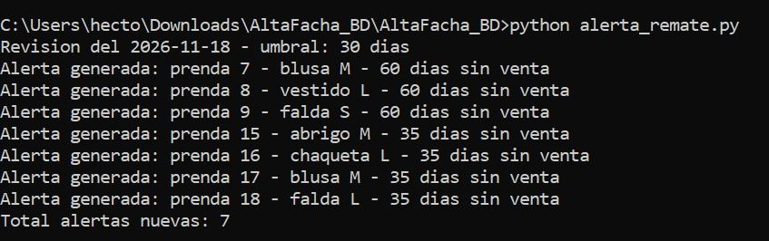
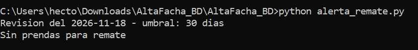
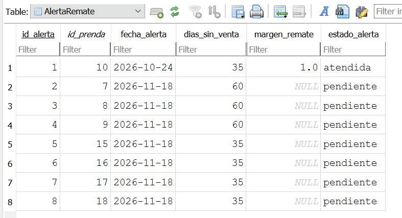
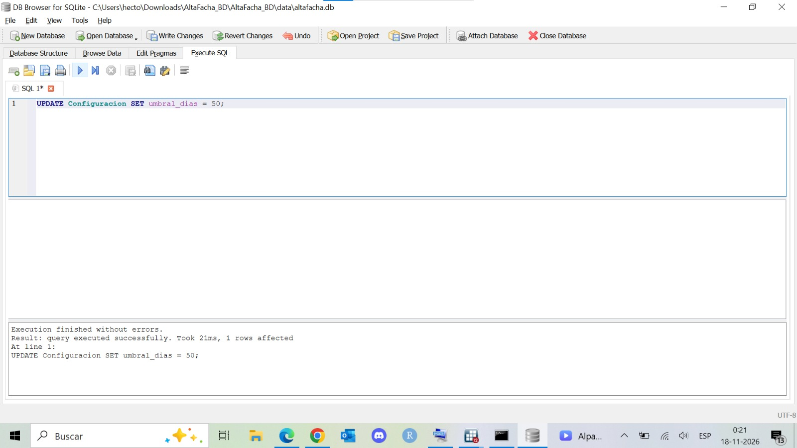
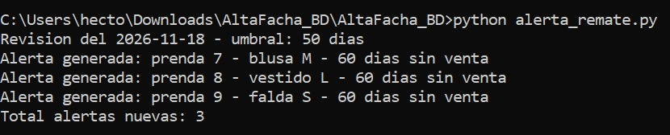
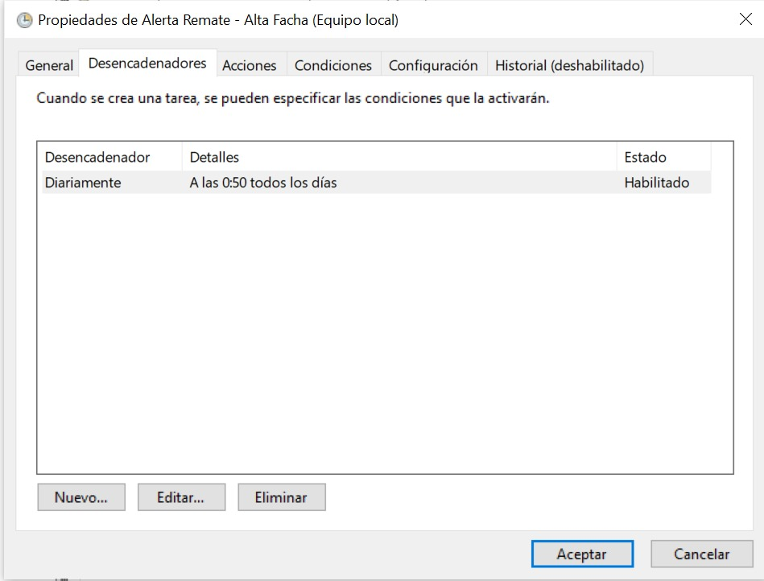
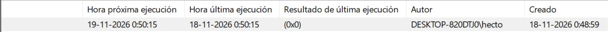
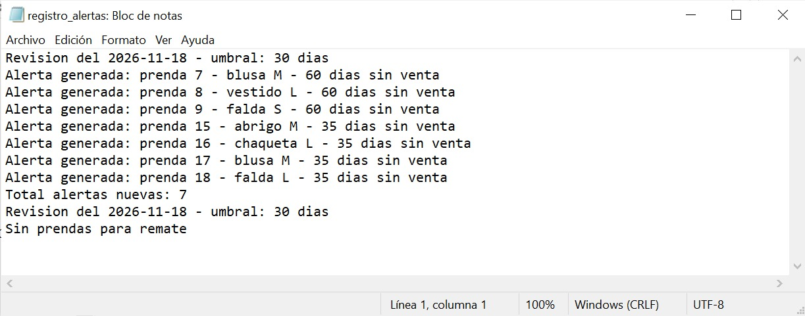

# F. Automatización: alerta de remate

## F.1 Objetivo y vínculo con el BPMN To-Be

La automatización implementa la parte independiente del BPMN To-Be: un evento temporizador activa periódicamente la evaluación de días sin venta de cada prenda y, mediante un gateway XOR, genera o no una alerta de remate para Belén.

Con esto se reemplaza la práctica actual (As-Is), en que Belén identifica "al ojo" al final de la temporada las prendas que no se vendieron, sin datos sobre su antigüedad.

## F.2 Herramienta utilizada

La revisión se implementó con un script en Python (`alerta_remate.py`) programado con el Programador de tareas de Windows, como herramienta homóloga a n8n. Se optó por esta alternativa porque n8n no tiene acceso directo a la base SQLite del SIG, mientras que Python se conecta a ella sin instalar nada adicional, lo que hace la solución más simple de reproducir en localhost.

## F.3 Evento que la activa

Una ejecución diaria programada. El archivo `ejecutar_alerta.bat` ejecuta el script y agrega su resultado al registro `data/registro_alertas.txt`, de modo que cada revisión queda documentada.

## F.4 Datos utilizados

| Tabla | Uso |
|-|-|
| Configuracion | Umbral de días sin venta, ingresado por Belén desde la aplicación |
| Prenda | Estado de cada prenda (solo se evalúan las disponibles) |
| Lote | Fecha de recepción, desde la cual se cuentan los días sin venta |
| AlertaRemate | Registro de las alertas generadas |

## F.5 Lógica

1. Se lee el umbral definido por Belén.
2. Se buscan las prendas con estado *disponible* cuyos días desde la recepción del lote superan el umbral.
3. Se descartan las prendas que ya tienen una alerta pendiente, para no duplicarlas.
4. Por cada prenda encontrada se registra una alerta con estado *pendiente*.
5. Si no hay prendas sobre el umbral, la revisión termina con "Sin prendas para remate".

Luego, desde la aplicación, Belén atiende la alerta definiendo el margen de remate. El sistema calcula el precio de remate, deja la prenda en estado *en_remate* y marca la alerta como *atendida*.

## F.6 Ejecución

Desde la carpeta del proyecto:

    python crear_bd.py
    python alerta_remate.py

Para programarla: Programador de tareas → Crear tarea básica → Diariamente → Iniciar un programa → `ejecutar_alerta.bat`, indicando la carpeta del proyecto en "Iniciar en".

## F.7 Pruebas y resultados

Las pruebas se realizaron sobre los datos de prueba (umbral inicial de 30 días) en un computador distinto al de desarrollo, lo que además verifica que la solución es reproducible.

**Primera ejecución:** se generan 7 alertas, correspondientes a las prendas disponibles con 60 y 35 días sin venta.

**Segunda ejecución:** no se generan alertas nuevas, porque esas prendas ya tienen una alerta pendiente.

**Resultado en la base de datos:** la tabla AlertaRemate contiene una alerta atendida (registrada en los datos de prueba) y las 7 alertas pendientes generadas por el script, aún sin margen de remate.

**Umbral configurable:** al cambiar el umbral a 50 días, el script genera solo 3 alertas (prendas con 60 días), lo que demuestra que el parámetro ingresado por Belén controla la alerta.

**Ejecución programada:** la tarea se configuró para ejecutarse diariamente y corrió sin intervención manual, con resultado 0x0 (completada correctamente). El registro conserva cada revisión.

| Prueba | Resultado esperado | Resultado obtenido |
|-|-|-|
| Primera ejecución (umbral 30) | 7 alertas | 7 alertas |
| Segunda ejecución | Sin alertas nuevas | Sin alertas nuevas |
| Umbral 50 | 3 alertas | 3 alertas |
| Ejecución programada | Resultado 0x0 y registro actualizado | Resultado 0x0 y registro actualizado |
